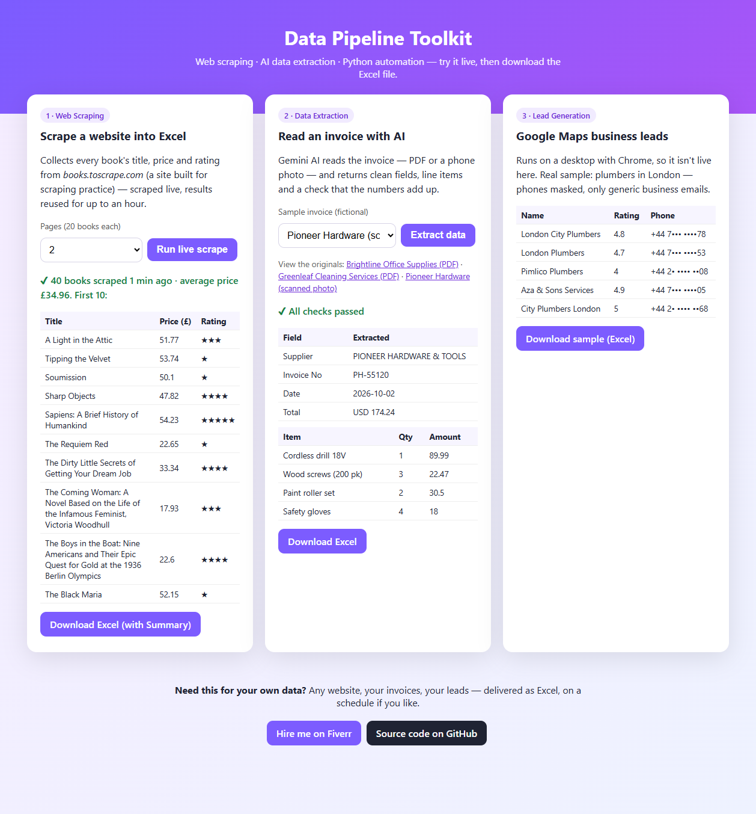
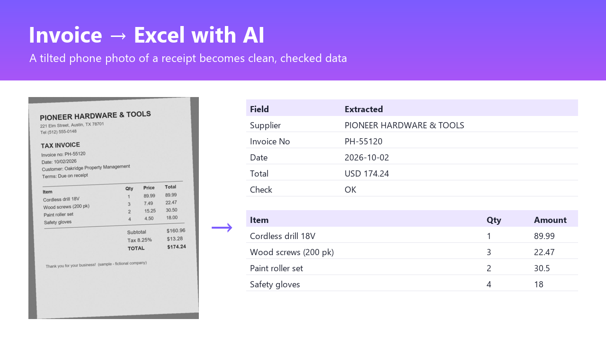
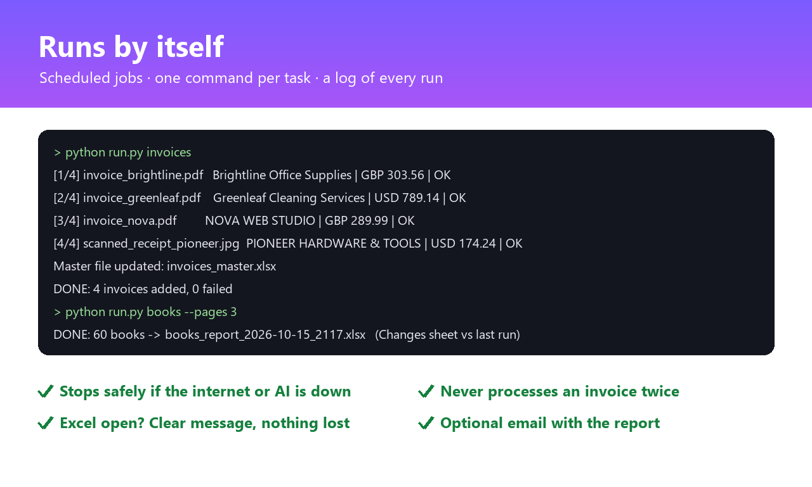

# Data Pipeline Toolkit

**Scrape websites, extract data from invoices with AI, and get clean Excel reports — automatically.**

**[▶ Try the live demo](https://systemsyncai.pythonanywhere.com/data-demo)** — run a live scrape or an AI invoice extraction and download the Excel file.



## What it does

| Module | What you get |
|---|---|
| **Web scraping** | Any listing site → Excel. Pagination, detail pages, retries, polite delays, stops safely when the connection drops. A **Changes** sheet shows new / removed items and **price changes** since the last run. |
| **AI data extraction** | Invoices and receipts (PDF or phone photo) → Excel with **Invoices** and **Line Items** sheets. Gemini AI reads the document; Python **checks the maths** (items vs subtotal, subtotal + tax = total) and flags anything a person should look at. |
| **Lead generation** | Google Maps search → business list (name, category, rating, phone, website, address), duplicates removed, optional **public business emails** from each website. |
| **Automation** | One command per job, a log file for every run, scheduled with Windows Task Scheduler or a cloud scheduler, the report **emailed** when it's done. An invoice **inbox folder** processes new files automatically and never processes the same invoice twice. |

## How it works

```
 1. COLLECT              2. CLEAN / EXTRACT              3. DELIVER
 websites       ──►      prices, ratings, dedupe   ──►   Excel (+ Summary sheet)
 Google Maps    ──►      phones, websites, emails  ──►   emailed on a schedule
 invoice files  ──►      Gemini AI + maths checks  ──►   master Excel, files sorted
```

## Screenshots

| Invoice photo → Excel with AI | Runs by itself |
|---|---|
|  |  |

## Sample outputs

- [Books report](samples/books_report_sample.xlsx) — Summary + Books sheets
- [Invoices master](samples/invoices_sample.xlsx) — Summary + Invoices + Line Items (fictional invoices in [`samples/invoices`](samples/invoices))
- [Leads](samples/leads_sample.xlsx) — real Google Maps results, phones masked, generic emails only

## Quick start

```bash
pip install -r requirements.txt
copy .env.example .env          # add your GEMINI_API_KEY (and Gmail settings for --email)

python run.py books --pages 5                                   # website -> Excel
python run.py invoices                                          # files in invoices/inbox -> Excel
python run.py leads --search "plumbers in london" --emails      # Google Maps -> Excel (needs Chrome)
python run.py books --pages 50 --email                          # ...and email the report
```

Reports are saved in `output/`, logs in `logs/`. Schedule everything with `schedule_windows.ps1`.

Run the live demo locally: `python -m web.app` → http://127.0.0.1:5000

## Built to run unattended

- Failed pages are retried, then skipped; after 3 failures in a row the run stops instead of hanging.
- Invoice files that are still being copied are left alone until they're complete.
- If the AI service is down, unprocessed invoices stay in the inbox for the next run — nothing is lost.
- Excel file open? A clear "close it and run again" message, and nothing is half-written.
- Exit code 0/1 so schedulers can tell success from failure.

## Tech stack

Python · requests · BeautifulSoup · Selenium · Google Gemini (google-genai) · pydantic · openpyxl · Flask · pytest (140+ automated tests) · Windows Task Scheduler / PythonAnywhere

## Project layout

```
core/         downloads with retries, Excel helpers, text cleaning, logging
scrapers/     books.py (websites), gmaps.py (Google Maps), emails.py (business emails)
extractors/   invoices.py (Gemini AI + checks)
automation/   report.py (Summary / Changes), inbox.py (invoice folder), notify.py (email)
web/          the live demo page
run.py        one command for every job
```

## Responsible scraping

- Before scraping a new site I check its `robots.txt` and terms of use; the scrapers use polite delays, timeouts and a browser User-Agent.
- Collects **public business information only**. Emails are only taken when they belong to the business's own website domain (or are its listed free-mail address).
- For UK/EU contacts, follow GDPR/PECR rules on how you use business emails.
- books.toscrape.com is a sandbox site made for scraping practice.

## Hire me

Need this for your website, your invoices or your market? **[Message me on Fiverr](https://www.fiverr.com/systemsyncai)** — send a sample and I'll show you the result first.
